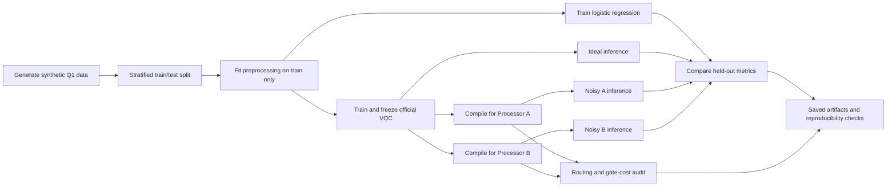
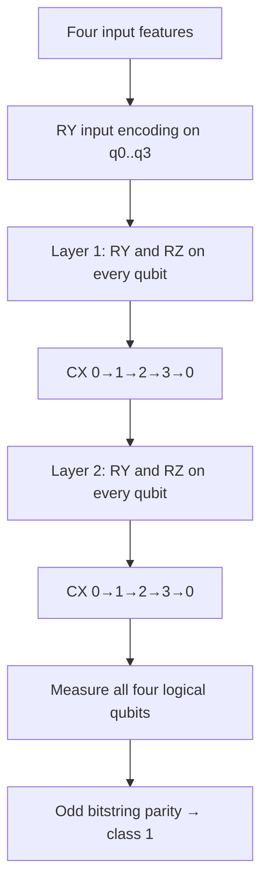
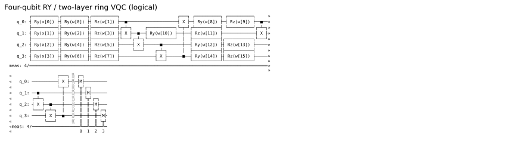
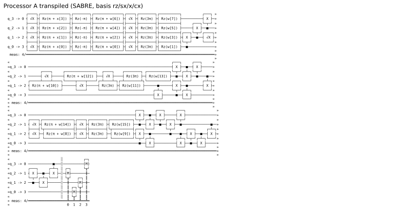
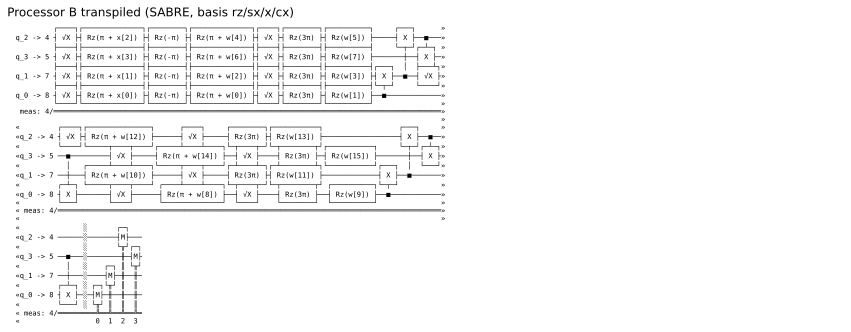

<div align="center">

# QFF 2026 · Quantum Machine Learning

### Architecture-Aware Variational Quantum Classification · Phase 1 · Q1

**A reproducible study of parity-readout VQC performance under processor connectivity and noise constraints.**


[**Research Question**](#research-question) · [**Circuit**](#official-quantum-circuit) · [**Architecture**](#processor-connectivity) · [**Results**](#measured-results) · [**Reproduce**](#reproduce-the-study) · [**Evidence**](#judging-evidence-index)

</div>

---

> [!IMPORTANT]
> **Scope:** This repository investigates the organizer-prescribed Phase 1 Q1 circuit on participant-designed Processor A (5-qubit line) and B (9-qubit grid) configurations. It does **not** establish quantum advantage, clinical ECG diagnosis, or a measured Processor D result. The synthetic data fixture includes the documented, **unconfirmed** `n_redundant=0` assumption.

## Research question

How do hardware connectivity, routing overhead, circuit depth, and prescribed noise affect a four-qubit parity-readout variational quantum classifier? We compare a frozen trained VQC against a logistic regression baseline and evaluate the *same circuit and weights* under two specified architecture classes.

### At a glance

| Study design | Value |
|---|---|
| Synthetic benchmark | 200 samples, 4 features; 160 train / 40 test |
| Quantum encoding | `RY(x[q])`, inputs scaled to `[0, π]` |
| Trainable circuit | 2 layers; per qubit `RY`, `RZ`, followed by a directed CX ring |
| Parameter count | 16 distinct trainable angles (not all output-effective) |
| Output | All-qubit bitstring parity; odd parity = label 1 |
| Processor A | 5 physical qubits, bidirectional line |
| Processor B | 9 physical qubits, bidirectional 3×3 grid |
| Compiler / sampling | SABRE, optimization level 1, seed 42, 4,096 shots |
| Benchmark status | Provisional synthetic study, not biomedical validation |

## Research workflow



## Official quantum circuit



**Verified circuit drawing (generated from Qiskit, not hand drawn):**



[Qiskit circuit builder](src/vqc.py) · [Full logical circuit text](results/tables/q1_provisional_logical_circuit.txt)

The classifier measures odd four-bit computational-basis parity (equivalently, the `Z0 Z1 Z2 Z3` parity observable). The six output-inert parameters are `w[9]`, `w[10]`, `w[11]`, `w[13]`, `w[14]`, and `w[15]`: all four final-layer RZ angles plus RY on q1 and q3. [Focused tests](tests/test_circuit_semantics.py) verify all 16 parity outcomes and parameter sensitivity; the final CX ring makes parity depend on the pre-ring q0 XOR q2 marginal. Do not change the official circuit to improve benchmark numbers.

## Processor connectivity

**Why the mapping matters:** A line does not directly realize the full four-qubit cycle. Routing operations are needed for some placements, whereas a suitable 3×3 grid placement can support this interaction pattern with less overhead.


| Compiled metric | Processor A · line | Processor B · grid |
|---|---:|---:|
| Physical qubits | 5 | 9 |
| Native CX count | **24** | **8** |
| Gate-only depth | **35** | **20** |
| Full measured depth | 36 | 21 |
| CX overhead vs reference | +16 | 0 |
| Gate-depth overhead | +15 | 0 |
| SWAP nodes observed in routing trace | 6 | 0 |

**Interpretation:** For this specific logical circuit, coupling maps, transpiler configuration and seed, B compiles to fewer native two-qubit operations. Routing-stage SWAP nodes are measured separately; do **not** infer their count by dividing decomposed CX overhead by three. This study does not establish universal superiority of B.

<table><tr><td width="50%"><b>Processor A: transpiled circuit</b><br/></td><td width="50%"><b>Processor B: transpiled circuit</b><br/></td></tr></table>

**Processor D** is a **concept only**: a ring-compatible topology might reduce routing for this interaction graph, but its noise, calibration trade-offs and measured performance are untested. No Phase 2 enhanced challenge was implemented.

## Measured results

### Held-out classification performance

| Configuration | Accuracy | Recall · label 1 | F1 |
|---|---:|---:|---:|
| Logistic regression | **0.875** | **0.850** | **0.872** |
| Official ideal VQC | 0.600 | 0.350 | 0.467 |
| Noisy Processor A | 0.550 | 0.250 | 0.357 |
| Noisy Processor B | 0.600 | 0.350 | 0.467 |

Logistic regression confusion matrix (`[0,1]`): `[[18,2],[3,17]]`; ideal VQC: `[[17,3],[13,7]]`. The official VQC underperforms the classical baseline and misses 13 of 20 positive synthetic examples in the ideal simulation.

**Separate recall-oriented sensitivity experiment:** A validation-selected decision threshold of 0.45 yielded test recall `0.800`, precision `0.516`, F1 `0.627`, accuracy `0.525`, specificity `0.250`. It is **not** the official benchmark or an improvement to the A/B results.

> [!CAUTION]
> **Synthetic labels are not medical diagnoses.** No clinical validity, quantum advantage, or real hardware performance is claimed. The 40-example test set limits statistical precision.

## Reproduce the study

Use the tested Python 3.11 environment from the repository root:

```bash
python3 -m venv .venv
source .venv/bin/activate
python -m pip install -r requirements.txt
python -m pip check
python -m unittest discover -s tests -v
python -m src.q1_submission
python -m src.judge_diagnostics
python -m src.judge_statistics
python -m src.judge_robustness
python -m src.recall_calibration
python -m src.judge_figures
python -m src.architecture_concept
```

With all tracked artifacts present, `src.q1_submission` validates and loads the saved official experiment without retraining or noisy resimulation. The diagnostic, statistics, compiler-seed, calibration-artifact and figure commands operate on saved outputs; no parameter search is performed. If the official manifest or required model files are absent, the submission CLI may train and benchmark, so do not remove those artifacts before a reproduction run. For verified command outcomes, see the [verification record](docs/FINAL_VERIFICATION.md), [executed notebook](main.ipynb), and [submission checklist](docs/SUBMISSION_CHECKLIST.md).

## Judging evidence index · confirmed Phase 1 rubric

| Criterion | Weight | Evidence |
|---|---:|---|
| Technical correctness | 30 | [Circuit implementation](src/vqc.py), [executed notebook](main.ipynb), tests and parity validation |
| Processor A/B benchmarking | 25 | [A/B topology and conceptual D](results/figures/architecture_problem_and_D_concept.svg), [report](report.md), transpiled circuit figures |
| Performance analysis | 20 | [Report](report.md), benchmark tables, confusion matrices, routing trace and trainability notes |
| Code quality and reproducibility | 15 | [Verification](docs/FINAL_VERIFICATION.md), tests, frozen hashes, documented CLI reproduction |
| Technical explanation | 10 | [Judge summary](docs/JUDGE_SUMMARY.md), [architecture rationale](report.md), limitations and D hypothesis |

## Research integrity and limitations

- **Dataset specification:** `make_classification(n_samples=200, n_features=4, n_informative=3, n_redundant=0, random_state=42)`; the explicit `n_redundant=0` repairs an invalid default combination and is **not yet organizer-approved**.
- **Train/test separation:** a shared stratified 160/40 split; preprocessing fitted on training rows only.
- **Representativeness:** MIT-BIH CSV adapter exists but no biomedical data was used in this benchmark.
- **Trainability:** structural parameter inactivity must be supported by a proof or targeted numerical evidence, not a claim based on one trained point.
- **Architecture claims:** results are limited to the reported participant-designed coupling maps, compiler settings, and synthetic benchmark.
- **Phase boundary:** D is a proposal, not a compiled or benchmarked processor.

## Team

**MOM'S MAGIC** — MATTA VIJAY, GUDE YUVA NIKESH, and BOLLA DINESH KUMAR.

## Repository guide

| Resource | Purpose |
|---|---|
| [Source code](src/) | Data processing, classifier and benchmarking implementation |
| [Notebook](main.ipynb) | Executed experiment narrative |
| [Report](report.md) | Full methodology, interpretation and results |
| [Judge summary](docs/JUDGE_SUMMARY.md) | Short evaluator-friendly overview |
| [Verification](docs/FINAL_VERIFICATION.md) | Reproduction and artifact-integrity evidence |
| [Figures](results/figures/) | Generated circuits, processor maps and performance figures |
| [Tables](results/tables/) | Machine-readable measurement evidence |

---

<div align="center">

**Qiskit Fall Fest 2026 · Phase 1 · QML / Q1**

*Reproducible evidence over inflated claims · Architecture-aware quantum benchmarking*

</div>
