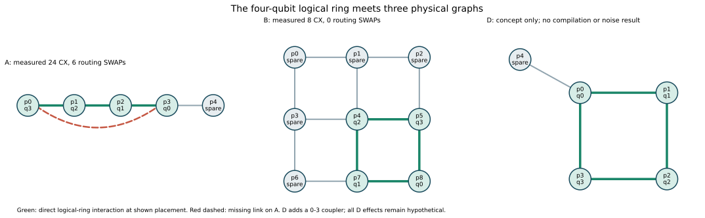

# Processor D: conceptual ring-compatible architecture

**Status:** supplemental illustration requested by the team following organizer confirmation of the updated rubric. It is **not** an organizer-released Processor D, a Phase 1 benchmark result, or a Phase 2 implementation. The highest-priority local Phase 1 Master Guide (pp. 1, 7) limits required execution to Processors A and B and reserves C/D for finalists. The updated announcement file is not included in the local organizer PDF directory.

## Observed bottleneck

The frozen logical circuit applies the directed CX ring `q0→q1→q2→q3→q0` twice. Under the recorded seed-42 SABRE initial placement on the participant-designed five-qubit line, the first three required neighboring pairs map to direct links while the ring-closing pair does not. Qiskit inserts **six explicit SWAP nodes after SabreLayout** across the circuit; the final native-basis circuit has 24 CX and gate-only depth 35, versus the unconstrained 8 CX and depth 20. The +16 CX/+15 depth differences are measured compilation overhead proxies, not an exact SWAP decomposition.

The participant-designed nine-qubit grid embeds the same four-node ring directly at its recorded placement. Its seed-42 compile has zero routing-stage SWAP nodes, 8 CX and gate-only depth 20. That measured result is specific to this circuit, maps, compiler and seed. It does not show that extra qubits alone caused the saving or that B has better classification performance in general.

## Proposed graph and mapping

Use a **five-qubit** graph with bidirectional physical links `(0,1), (1,2), (2,3), (3,0), (0,4)`. Map logical `q0,q1,q2,q3` initially to physical `p0,p1,p2,p3`; `p4` is a connected spare. The four CX pairs then each have a direct physical link. Relative to A's line, the critical new link is `p3—p0`. The [schematic](../results/figures/architecture_problem_and_D_concept.svg) draws the actual A/B JSON graphs and recorded placements alongside this proposed graph. It labels the D panel as conceptual and unmeasured. The figure generator is [architecture_concept.py](../src/architecture_concept.py).

## Expected benefit and trade-off

A fixed placement on this graph could avoid routing SWAPs for the two logical ring layers while using five declared physical qubits rather than B's nine. This is a **topological expectation**, not a transpilation or noisy-inference measurement: optimization may alter gates, and other circuits may need different links. Adding the `p3—p0` coupler can raise fabrication, calibration, cross-talk and frequency-collision burdens. A sparse five-node ring also gives fewer alternate placements than B's grid, so it may be less resilient to one poor edge or disabled qubit. Any reduction in gate count could be offset by worse physical error rates; the current uniform synthetic noise model cannot quantify that trade-off.

If D becomes an authorized Phase 2 target, define its official qubit budget and noise assumptions first, then compile the **same frozen logical circuit and weights** with a declared layout, compare cost against A/B, and run matched ideal/noisy inference only under approved settings. No D result or advantage is claimed here.
