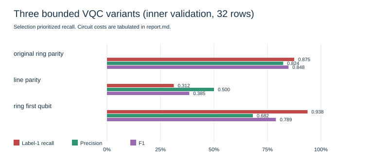
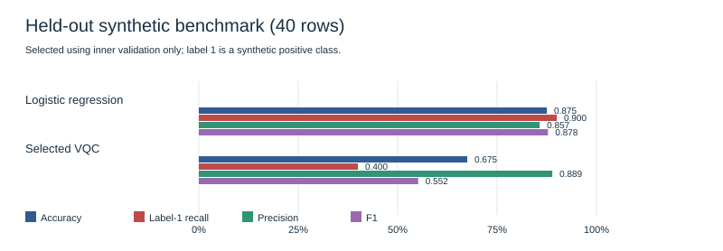
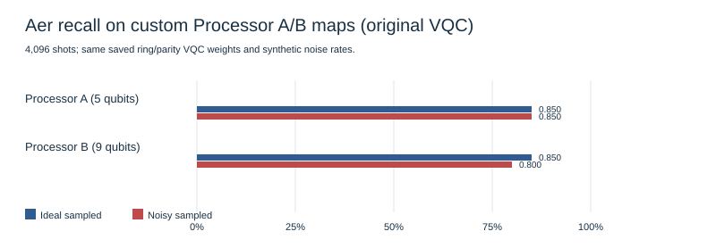

# QFF 2026 QML Q1 — recorded synthetic study

## Selected working problem statement

Build a four-qubit hybrid variational quantum classifier for binary classification on a reproducible four-feature synthetic benchmark. Compare with logistic regression and simulate the **original** VQC on Processor A (5 qubits) and Processor B (9 qubits). No authoritative Q1 architecture or organizer dataset document was available in this repository. The biomedical dataset choice and coupling-map authority remain unresolved in [docs/DECISIONS.md](../../../docs/DECISIONS.md); this report does not claim organizer endorsement.

## Dataset provenance and method

The benchmark is generated locally with scikit-learn `make_classification(n_samples=200, n_features=4, random_state=42)` as implemented in `src/datasets.py`. A stratified 80/20 split with seed 42 gives 160 training and 40 held-out test rows, with 20 examples of each class in the test set. Label 1 is the positive or “abnormal” **synthetic proxy** class; no biomedical records or clinical labels were used. A training-fitted `MinMaxScaler` maps features to `[0, π]` for the classical and quantum models. The configurable MIT-BIH feature CSV adapter was not used because no local dataset was supplied.

The classical model is `LogisticRegression(random_state=42, max_iter=1000)`. The original VQC uses four RY input angles, two trainable RY/RZ plus ring-CX layers, parity readout, exact `QMLSampler` statevector probabilities, and 25 COBYLA evaluations. Its saved parameters were preserved. For controlled selection, three fixed variants used a stratified 128/32 split *within* outer training, a scaler fitted only to the 128 fit rows, seed 42, and the same 25-evaluation budget. Variants were ranked by validation label-1 recall, then precision, F1, lower A/B routing CX overhead, and listed order. The chosen variant was refitted on all 160 outer-training rows before one held-out evaluation. No test result entered selection.

## Controlled validation results

| Variant | Label-1 recall | Precision | F1 | Unconstrained CX / depth | A CX / depth, overhead | B CX / depth, overhead |
|---|---:|---:|---:|---:|---:|---:|
| Original ring/parity | 0.875 | 0.824 | 0.848 | 8 / 21 | 24 / 36, +16 / +15 | 8 / 21, +0 / +0 |
| Line/parity | 0.313 | 0.500 | 0.385 | 6 / 18 | 6 / 18, +0 / +0 | 6 / 18, +0 / +0 |
| **Ring/first-qubit readout (selected)** | **0.938** | 0.682 | 0.789 | 8 / 21 | 24 / 36, +16 / +15 | 8 / 21, +0 / +0 |

Rates are from 32 inner-validation rows. Circuit metrics use the same `rz/sx/x/cx` basis, transpiler level 1 and seed 42. Routing overhead is the CX/depth delta from unconstrained transpilation; it is a compilation proxy. A/B maps are custom illustrations. Full configurations, indices, scaler bounds, predictions, weights, and results are in [results/vqc_controlled_experiments.json](vqc_controlled_experiments.json).



## Held-out classical versus VQC results

| Model | Accuracy | Label-1 recall | Precision | F1 | Confusion matrix, labels [0, 1] |
|---|---:|---:|---:|---:|---|
| Logistic regression | 0.875 | 0.900 | 0.857 | 0.878 | `[[17, 3], [2, 18]]` |
| Original ring/parity VQC | 0.625 | Not recorded | Not recorded | Not recorded | Not recorded |
| Selected ring/first-qubit VQC, full-training refit | 0.675 | 0.400 | 0.889 | 0.552 | `[[19, 1], [12, 8]]` |

The original VQC artifact recorded accuracy only; this report does not infer its other exact-statevector metrics from a different simulation. The selected variant’s validation recall of 0.938 fell to 0.400 on the held-out set. The 32-row validation sample and short optimizer budget limit how much to infer from the selection. The logistic baseline remains stronger on this recorded held-out benchmark. Baseline and selected-model outputs are in [results/logistic_regression_baseline.json](logistic_regression_baseline.json) and [results/vqc_selected_parameters.json](vqc_selected_parameters.json). The older baseline JSON records scikit-learn 1.9.0; the controlled VQC run records 1.9.1.



## Simulated Processor A/B comparison

This comparison uses the **original ring/parity VQC weights**, not the selected first-qubit-readout model. Both Aer runs use the same 40 held-out examples, parameters, basis gates (`rz`, `sx`, `x`, `cx`), optimization level 1, transpiler/simulator seed 42, 4,096 shots per circuit, and noise rates. “Ideal” here means finite-shot sampling without injected noise. The unconstrained compile is 8 CX and depth 21.

| Custom processor map | CX | Depth | Routing overhead CX / depth | Ideal label-1 recall | Noisy label-1 recall |
|---|---:|---:|---:|---:|---:|
| A: bidirectional five-qubit line | 24 | 36 | +16 / +15 | 0.85 | 0.85 |
| B: bidirectional nine-qubit 3×3 grid | 8 | 21 | +0 / +0 | 0.85 | 0.80 |

The shared illustrative noise model applies one-qubit depolarizing probability 0.001 to `rz/sx/x`, two-qubit depolarizing probability 0.01 to `cx`, and symmetric readout bit-flip probability 0.02. These are assumptions, not measured processor calibrations. The maps are **custom**, not organizer reference coupling maps. Full settings and predictions are in [results/processor_benchmark.json](processor_benchmark.json).



## Limits and execution

This is a small synthetic fixture, not a biomedical validation study. The MIT-BIH adapter requires a separately obtained, pre-extracted local feature CSV. No patient-level split, clinical metric, uncertainty interval, hardware execution, or physical-device calibration is claimed. Reference coupling maps and organizer dataset selection still need confirmation. The processor table cannot be interpreted as a processor comparison for the newly selected readout.

From the repository root with Python 3.11+:

```sh
python3 -m venv .venv
source .venv/bin/activate
python -m pip install -r requirements.txt
python -m unittest discover -s tests -v
python -m src.baseline
python -m src.vqc
python -m src.vqc_experiments
python -m src.processor_benchmark
python -m src.result_figures
```

Open `main.ipynb` in a Jupyter-capable environment using the same virtual environment as its Python kernel and run all cells from the repository root. The notebook writes separate `results/notebook_*` outputs. Jupyter itself is not a runtime dependency of the CLI pipeline. The `results/` directory is ignored by `.gitignore`, so retain the JSON and SVG files alongside any shared copy of this report.
